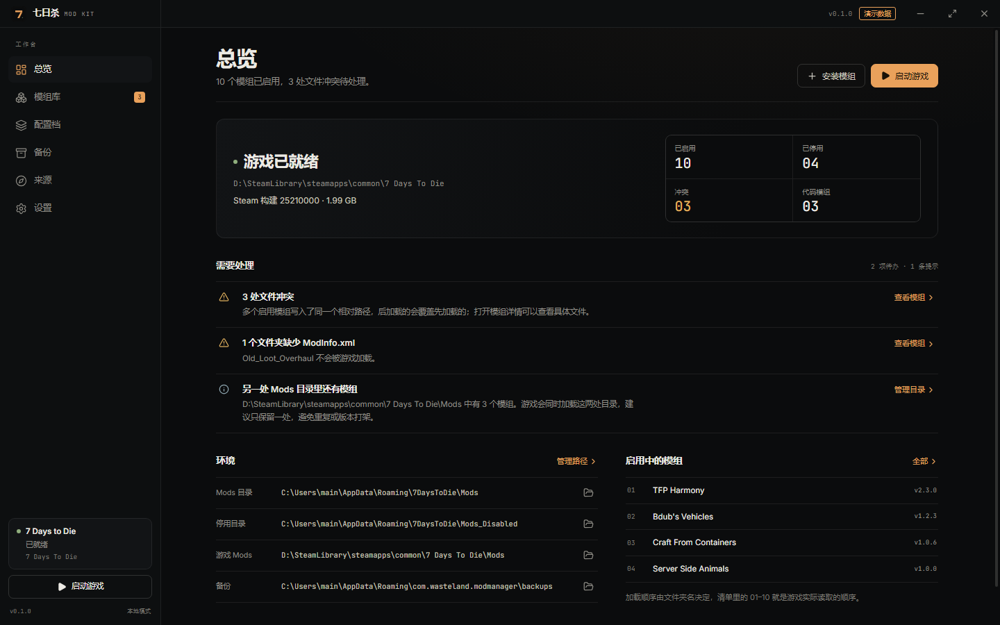
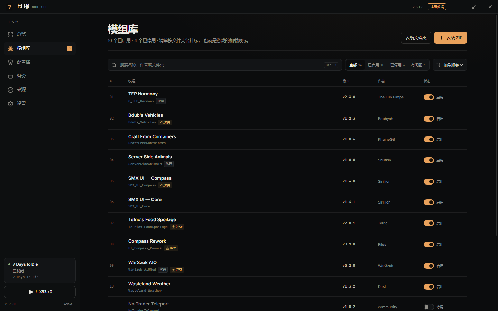
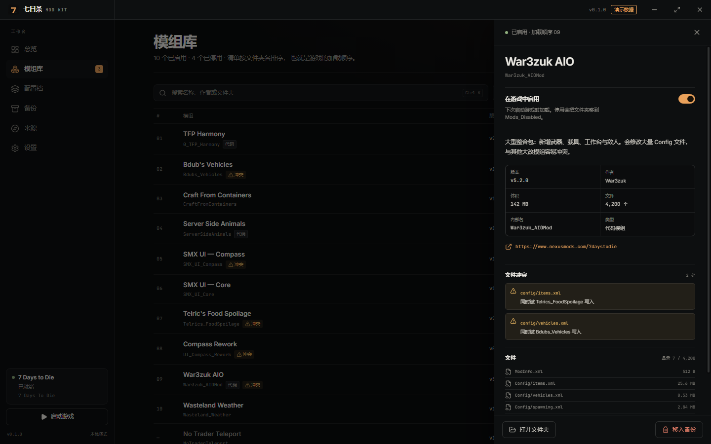
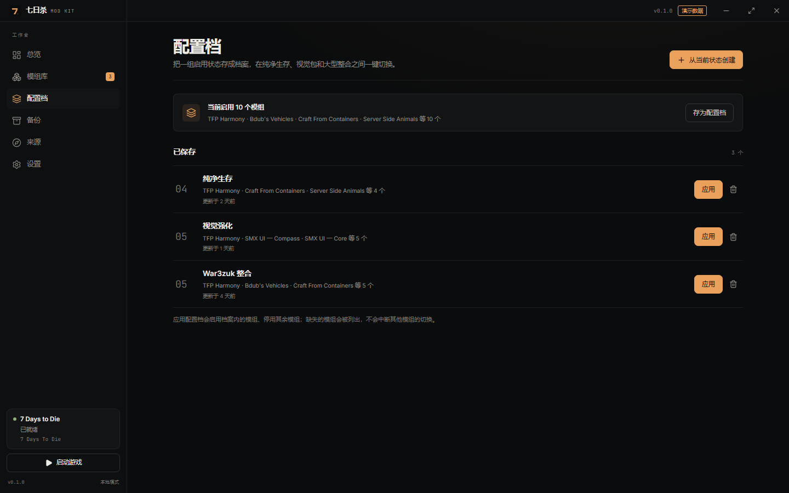
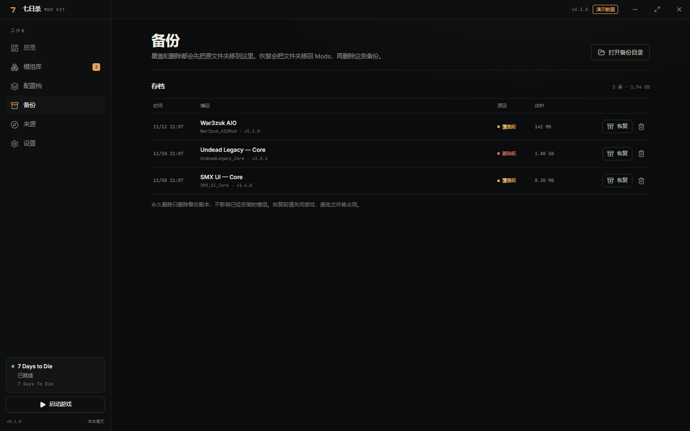
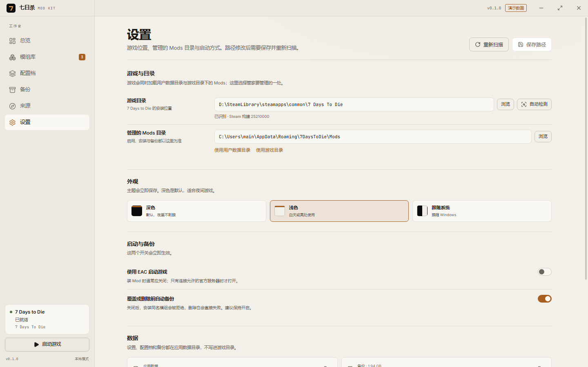
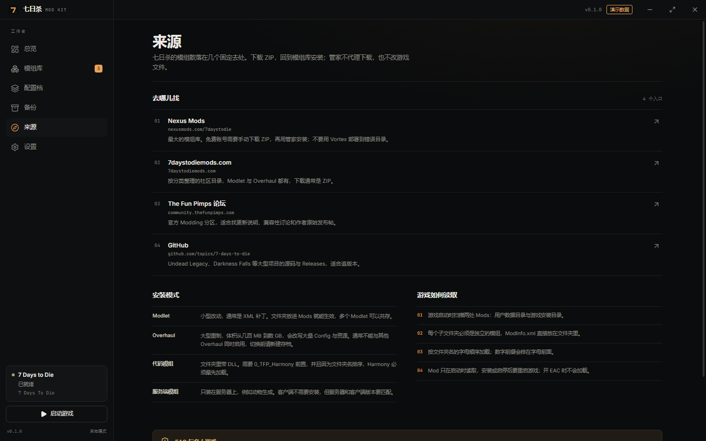

# 七日杀 Mod 管家

用 Rust + Tauri 2 + React/TypeScript 写的本地《七日杀》（7 Days to Die）Mod 管理器。
它不下载 Mod，而是把已经下载的 ZIP、文件夹和两处 `Mods` 目录整理成一份可读、可启停、可回滚的清单。



## 能做什么

- **自动找游戏**：Steam 注册表 + `libraryfolders.vdf` + 常见路径；支持手动指定。
- **两处 Mods 都认识**：`%APPDATA%\7DaysToDie\Mods` 与游戏目录 `Mods`，会提示另一处残留的模组。
- **扫描 ModInfo.xml**：兼容 A21+ `<xml>`、旧版 `<ModInfo>`、属性/元素/文本写法；损坏 XML 会降级读取。
- **启用 / 停用**：文件夹在 `Mods` 与同级 `Mods_Disabled` 之间移动，不靠改后缀，游戏不会误加载。
- **安装**：ZIP（可含多个 Mod）或文件夹；安全解压、识别嵌套根目录、覆盖前自动备份。
- **配置档**：把当前启用集合存成档案，一键切换；缺失 Mod 会单独列出。
- **备份**：覆盖与删除先落到应用数据目录，可恢复、可永久删除。
- **健康检查**：同路径文件冲突、重复内部名、缺少 Harmony、目录不可写、游戏运行中等。
- **启动游戏**：EAC 关闭 / 开启两种入口；中文路径无压力。
- **界面**：深色 / 浅色 / 跟随系统；拖拽安装；安装进度事件；`Ctrl K` 搜索。



## 快速开始

要求：Windows 10/11、WebView2、Rust 1.88+、Node.js 20+、pnpm。

```bash
pnpm install
pnpm tauri dev          # 开发模式
pnpm tauri build        # 发布安装包
```

构建产物：

- `src-tauri/target/release/wasteland-mod-manager.exe`：免安装可执行文件
- `src-tauri/target/release/bundle/nsis/WastelandModManager_0.1.0_x64-setup.exe`：NSIS 安装包

本仓库的 `release/` 目录也放了一份已构建的版本；未签名，首次运行可能触发 SmartScreen 提示。

开发时只跑前端（会进入演示数据模式）：

```bash
pnpm exec vite --host 127.0.0.1 --port 47185 --strictPort
# http://127.0.0.1:47185
```

演示模式只在 `import.meta.env.DEV` 且没有 Tauri 注入时启用；打包后的程序始终走真实 Rust 后端。

## 使用说明

1. 首次启动会自动找 Steam 游戏目录；找不到就到「设置」手动指定。
2. 「设置 → 管理的 Mods 目录」选择要管理的一处；默认优先用户数据目录。
3. 「模组库 → 安装 ZIP / 安装文件夹」，或把 ZIP 直接拖进窗口。
4. 清单里的 `01、02…` 就是游戏按文件夹名排序后的加载顺序；修改后重启游戏生效。
5. 换玩法前，在「配置档」里保存当前启用集合；之后一键切回。
6. 误删或覆盖错了，到「备份」恢复。

### 目录与数据

| 内容 | 位置 |
| --- | --- |
| 设置 | `%APPDATA%\com.wasteland.modmanager\settings.json` |
| 配置档 | `%APPDATA%\com.wasteland.modmanager\profiles.json` |
| 备份 | `%APPDATA%\com.wasteland.modmanager\backups\` |
| 停用模组 | 与当前 `Mods` 同级的 `Mods_Disabled` |
| 游戏 | Steam 库中的 `steamapps\common\7 Days To Die` |

备份目录结构：

```
backups/
  <时间戳>_<文件夹名>/
    meta.json
    mod/            # 原模组文件夹的内容
```

## 安全设计

- 不修改游戏本体、不注入进程、不绕过 EAC。
- 覆盖与删除默认先备份；关闭自动备份时，覆盖会被直接拒绝，而不是静默删除。
- 恢复备份时如果目标已存在，会拒绝而不是覆盖。
- ZIP 解压做了路径穿越、绝对路径、Windows 保留名与解压体积限制。
- 所有操作限制在当前管理的 `Mods` 目录内，符号链接会被拒绝。
- 游戏运行中仍可浏览，但界面会提示改动不会立即生效。

## 技术结构

```
src/                       React + TypeScript
  入口.tsx
  应用.tsx                 窗口、路由(hash)、全局状态、安装进度、拖拽
  组件/                    标题栏、侧边栏、开关、弹窗、抽屉、提示
  页面/                    总览、模组库、配置档、备份、来源、设置
  数据/                    类型、接口、演示数据、格式化
  样式/                    设计变量、基础样式、应用样式
src-tauri/                 Rust
  src/lib.rs               模块声明（中文文件名使用 #[path]）
  src/工具.rs              路径安全、移动/复制、可写检查
  src/模组信息.rs          ModInfo.xml 严格 + 宽松解析
  src/游戏.rs              Steam 目录发现、启动、运行检测
  src/模组库.rs            扫描、冲突、健康检查、启停
  src/安装.rs              ZIP/文件夹安装、进度事件
  src/备份.rs / 配置档.rs  备份与配置档
  src/命令.rs              Tauri commands
```

命名约定：源码文件、模块、函数与局部变量尽量使用中文；跨越 JSON/IPC 的字段保留 `camelCase` 英文，避免序列化契约随命名变化。Rust 模块文件名用 `#[path = "工具.rs"]` 显式声明。

## 测试

```bash
cd src-tauri
cargo test              # 15 个单元测试：ModInfo 解析、路径安全、启停、冲突、Steam VDF
cd ..
pnpm typecheck
pnpm build
```

另外在真实 Tauri 窗口里做过一轮手动验收：中文路径扫描、UI 启停、ZIP 安装、删除→备份→恢复、配置档保存/应用、窗口最大化/还原/关闭。自动化截图使用 `#/` 哈希路由直接打开各页面。

## 已知限制

- 只支持 `.zip`；`.7z` / `.rar` 需要先解压（会给出提示）。
- 没有内置下载器 / Nexus OAuth；来源页提供入口，安装由本工具完成。
- 不做自动加载顺序重命名（避免擅自改文件夹名），只展示真实顺序。
- 目前只针对 Windows；Rust 侧的游戏检测与运行检测有 `cfg(windows)` 分支。
- 冲突检测是“相同相对路径”级别，不做 XML 补丁语义 diff。
- 可执行文件未签名；SmartScreen 可能提示“更多信息 → 仍要运行”。

## 参考资料

- [The Fun Pimps：ModInfo.xml V2 布局](https://community.thefunpimps.com/threads/what-is-the-new-layout-for-modinfo-xml-v2.32514/)
- [7 Days to Die Wiki：Mod 结构](https://7daystodie.fandom.com/wiki/Mod_structure)
- [7daysModLauncher（.NET 开源实现）](https://github.com/CornerWL/7daysModLauncher)
- [Nexus Mods：7 Days to Die](https://www.nexusmods.com/7daystodie)
- [7daystodiemods.com](https://7daystodiemods.com/)
- [Vortex 的 7DTD 加载顺序说明（文件夹名前缀）](https://community.thefunpimps.com/threads/vortex-mod-launcher.10570/)

## 截图

| 模组详情 | 配置档 |
| --- | --- |
|  |  |

| 备份 | 浅色主题 |
| --- | --- |
|  |  |

| 来源 |
| --- |
|  |

> 截图使用开发演示数据，用于展示界面；实际数据来自本机 `Mods` 目录。
